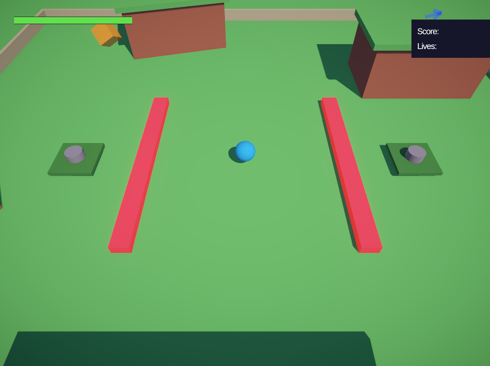
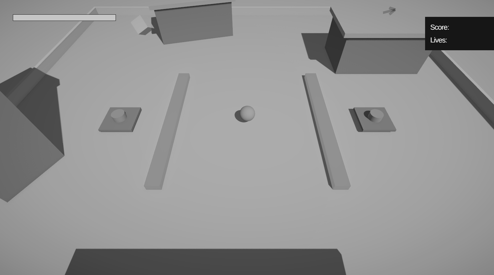

# CS464 Assignment 04 · Abdullah Saeed - BSCS25067
**Video (90–180 s):** [YouTube (unlisted) or Google Drive link]

## Settings
| Part | Setting | Value | Why |
|---|---|---|---|
| A | Harmony & base hue | Triadic, 230° | Mario-inspired cobalt blue base with high-visibility red hazards, distint pickups and green jump pads |
| A | Dark, mid, light | `#141829` `#7BA3FF` `#F4F6FC` | Distinct luminance bands keep panels, the rolling ball, and HUD text separated in grayscale |
| A | Accents | `#C92A38` `#62E04C` | Crimson flags spikes, crushers, and patrolling AI; green highlights jump pads, pickups, and health |
| A | `#F4F6FC` on `#141829` | 16.30: 1 | Exceeds WCAG 4.5:1 for crisp HUD score and lives text on solid panels |
| A | `#141829` on `#62E04C` | 10.30: 1 | Exceeds WCAG 4.5:1 for readable dark labels on bright green menu buttons |
| B | Music & SFX groups, as mixed | Music -6 dB, SFX 0 dB | Keeps SFX audible over background music without clipping |
| B | Slider at 1, 0.5, 0.0001 | 0 dB, -6 dB, -80 dB | Logarithmic conversion (`Log10(v) * 20`) matches human hearing |
| C | Patrolling AI Hum, in Level 2 | Linear, Min 2 m, Max 16 m | Linear rolloff fades the hum to complete silence once the ball leaves the patrol zone |
| C | Crusher Machinery, in Level 3 | Logarithmic, Min 3 m, Max 30 m | Logarithmic rolloff (-6 dB per doubling) lets the player hear the crusher faintly from afar |
| C | AudioListener | On the player (`ListenerOnPlayer.cs`) | Follow camera sits several metres back, so placing the listener at the ball's position with camera rotation keeps 3D distance and stereo accurate |
| D | [unlocked] | int · default [1] | |
| D | [best1] ... [best5] | float · [HasKey first] | |
| D | [MusicVolume] | float · default [1] | |
## Answers
1. **What `Time.timeScale = 0` stops in my game, and what it doesn't:** [answer]
2. **What survives a LoadScene in my game, and how:** [answer]
3. **Why every PlayerPrefs read in my game has a default:** [answer]
4. **An exception a forgotten unsubscribe would throw, and why mine can't:** [answer]
## Credits
- [Sound or track] · [who made it] · [link] · [licence]