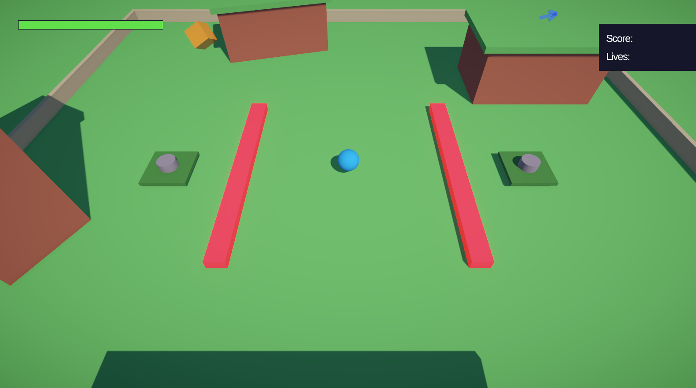

# CS464 Assignment 04 · Abdullah Saeed - BSCS25067
**Video (90–180 s):** [Google Drive Link](https://drive.google.com/file/d/1thIXKDK5B8_PNV66BKUeVpgT4pyZTAFX/view?usp=sharing)

## Settings
| Part | Setting | Value | Why |
|---|---|---|---|
| A | Harmony & base hue | Triadic, 230° | Mario-inspired cobalt blue base with high-visibility red hazards, distint pickups and green jump pads |
| A | Dark, mid, light | `#141829` `#7BA3FF` `#F4F6FC` | Distinct luminance bands keep panels, the rolling ball, and HUD text separated in grayscale |
| A | Accents | `#C92A38` `#62E04C` | Crimson flags spikes, crushers, and patrolling AI; green highlights jump pads, pickups, and health |
| A | `#F4F6FC` on `#141829` | 16.30: 1 | Exceeds WCAG 4.5:1 for crisp HUD score and lives text on solid panels |
| A | `#141829` on `#62E04C` | 10.30: 1 | Exceeds WCAG 4.5:1 for readable dark labels on bright green menu buttons |
| B | Music & SFX groups, as mixed | Music -6 dB, SFX 0 dB | Keeps SFX audible over background music without clipping |
| B | Slider at 1, 0.5, 0.0001 | 0 dB, -6 dB, -80 dB | Logarithmic conversion (`Log10(v) * 20`) matches human hearing |
| C | Patrolling AI Hum, in Level 2 | Linear, Min 2 m, Max 16 m | Linear rolloff fades the hum to complete silence once the ball leaves the patrol zone |
| C | Crusher Machinery, in Level 3 | Logarithmic, Min 3 m, Max 30 m | Logarithmic rolloff (-6 dB per doubling) lets the player hear the crusher faintly from afar |
| C | AudioListener | On the player (`ListenerOnPlayer.cs`) | Follow camera sits several metres back, so placing the listener at the ball's position with camera rotation keeps 3D distance and stereo accurate |
| D | `unlocked` | int, default 1 | Ensures Level 1 is playable on a fresh install or after clearing PlayerPrefs |
| D | `best1`–`best5` | float, `HasKey` first | Prevents displaying `0.00s` as a fake best time for unplayed levels |
| D | `MusicVolume` | float, default 1 | Starts music at full slider volume (0 dB) until the player adjusts it |

## Answers
1. **What `Time.timeScale = 0` stops in my game, and what it doesn't:**
   Setting `Time.timeScale` to `0` stops physics (`FixedUpdate`), `Time.deltaTime` movement, coroutines using `WaitForSeconds`, and `Time.timeSinceLevelLoad`. However, `Update()` still runs every frame, UI navigation continues, and audio keeps playing unless `AudioListener.pause` is set. That is why my ball controller checks `if (PauseMenu.IsPaused) return;` at the start of `Update()`, and `PauseMenu.Pause()` sets `AudioListener.pause = true` while `SfxPlayer` uses `ignoreListenerPause` for UI clicks.

2. **What survives a `LoadScene` in my game, and how:**
   My `PersistentMusic` and `SfxPlayer` objects survive every scene load because they call `DontDestroyOnLoad(gameObject)` with a singleton check in `Awake()` that destroys duplicates. Static state (`PauseMenu.IsPaused`, `Time.timeScale`, `AudioListener.pause`) also survives a load, so `PauseMenu.Resume()` and `LevelLoader` reset them before loading. Saved progress (`unlocked`, `best1`–`best5`, and `MusicVolume`) persists across sessions on disk through `PlayerPrefs`.

3. **Why every `PlayerPrefs` read in my game has a default:**
   On a fresh install or after `Edit > Clear All PlayerPrefs`, no keys exist on disk yet. Without defaults, `unlocked` would return `0` and lock Level 1, `MusicVolume` would return `0` (muting music at -80 dB), and `best1`–`best5` would show `0.00s` as a fake record. Defaulting `unlocked` and `MusicVolume` to `1` and checking `PlayerPrefs.HasKey` before reading best times keeps a fresh game playable.

4. **An exception a forgotten unsubscribe would throw, and why mine can't:**
   If a listener subscribes to a C# event in `OnEnable()` without unsubscribing in `OnDisable()`, reloading or unloading the scene destroys the listener while the publisher still holds a delegate pointing to it. When the event fires next, Unity throws a `MissingReferenceException` trying to access the destroyed object. Every listener in my game (`HealthBar`, `HitSparksListener`, `HitSoundListener`) pairs `+=` in `OnEnable()` with `-=` in `OnDisable()`, preventing dangling references.

## Credits
* Sound Effects — Kenney — [Kenney.nl](Kenney.nl) — CC0
* Music Sound Track — ZHRØ — [freesound.org](https://freesound.org/people/ZHR%C3%98/sounds/668879/) — Attribution 4.0